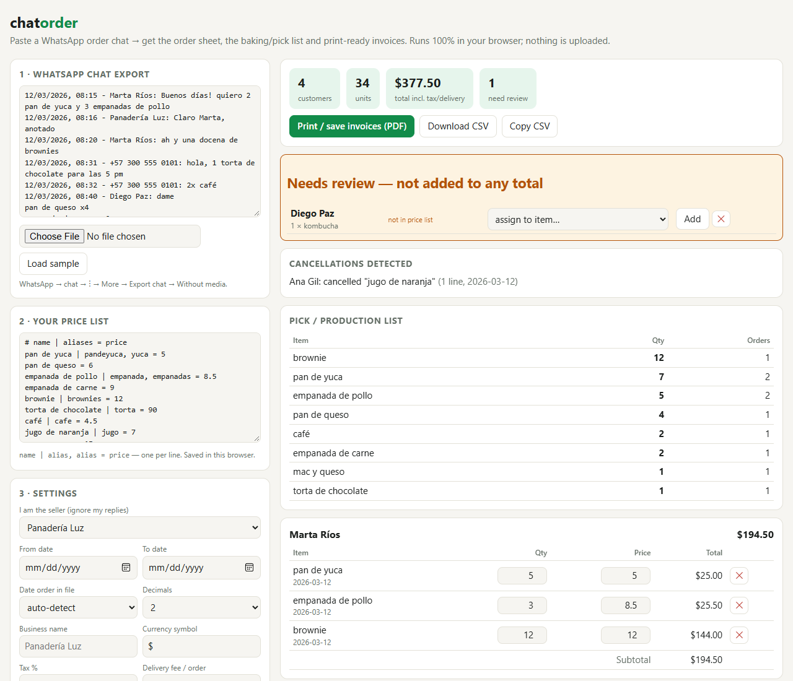

# chatorder

Paste a WhatsApp order chat, get a clean order sheet, a baking/pick list and print-ready invoices — offline, one HTML file, nothing uploaded.

> Built by the daily routine on 2026-10-08; published on 2026-10-22 because the push failed (GitHub access). Reconstructed from the run's own event log.



## Demo

Input — a normal WhatsApp "Export chat" file:

```text
12/03/2026, 08:15 - Marta Ríos: Buenos días! quiero 2 pan de yuca y 3 empanadas de pollo
12/03/2026, 08:20 - Marta Ríos: ah y una docena de brownies
12/03/2026, 08:40 - Diego Paz: dame
pan de queso x4
empanada de carne x2
1 kombucha
12/03/2026, 09:10 - Ana Gil: cancela los jugos
```

Output (`npm run demo` — same engine as the web page):

```text

Marta Ríos
     2 × pan de yuca            @     5.00 =    10.00
     3 × empanada de pollo      @     8.50 =    25.50
    12 × brownie                @    12.00 =   144.00
     2 × pan de yuca            @     5.00 =    10.00
                                          total   189.50

+57 300 555 0101
     1 × torta de chocolate     @    90.00 =    90.00
     2 × café                   @     4.50 =     9.00
                                          total    99.00

Diego Paz
     4 × pan de queso           @     6.00 =    24.00
     2 × empanada de carne      @     9.00 =    18.00
                                          total    42.00

Ana Gil
     2 × pan de yuca            @     5.00 =    10.00
     1 × mac y queso            @    15.00 =    15.00
     2 × empanada de pollo      @     8.50 =    17.00
                                          total    42.00

PICK LIST
    12 × brownie  (1 order)
     6 × pan de yuca  (2 orders)
     5 × empanada de pollo  (2 orders)
     4 × pan de queso  (1 order)
     2 × café  (1 order)
     2 × empanada de carne  (1 order)
     1 × mac y queso  (1 order)
     1 × torta de chocolate  (1 order)

CANCELLATIONS
  Ana Gil: cancelled "jugo de naranja"

NEEDS REVIEW
  Diego Paz: 1 × "kombucha"  [not in price list]
  Lucho: 1 × "pan"  [ambiguous: pan de yuca / pan de queso]

4 customers · grand total 372.50 · date order dmy
```

## Run it

- **Web:** open `index.html` (double-click; works offline). Paste or drop the chat `.txt`, edit the price list, done.
- **CLI (Node ≥ 18, zero deps):** `node cli.cjs chat.txt prices.txt --seller "My Shop Name" [--from 2026-03-12] [--csv]`
- **Tests:** `npm test`

## Price list format

```text
# name | alias, alias = price
pan de yuca | yuca, pandeyuca = 5
empanada de pollo | empanada = 8.50
```

Quantities understood: `2 pan`, `2x pan`, `pan x2`, `pan 2`, `tres brownies`, `una docena de…`, `media docena`, `1,5 kg de…` (Spanish, English, a little Portuguese). Several items per message (newlines, commas, "y"/"and", "+"). Accents, plurals and small typos are forgiven. Prices are per unit.

## Why it exists

Micro-sellers — bakeries, honey, produce, resellers — take orders in WhatsApp and then retype them into spreadsheets and invoices. The alternatives need the WhatsApp Business API, Twilio/n8n, an account, or a sales-team CRM. chatorder uses the plain "Export chat" file every phone can make. See [RESEARCH.md](RESEARCH.md).

## What you get

- Per-customer orders with editable quantity/price, subtotal, tax % and delivery fee
- **Pick / production list** across all customers ("bake 12 brownies today")
- Date range filter (paste a whole week, invoice only today); the seller's own replies are ignored
- Cancellations ("cancela los jugos" removes that item; "cancel my order" removes all)
- **Needs review** box for unknown/ambiguous items — never silently added to totals
- CSV export and one invoice page per customer (browser Print → Save as PDF)
- Price list and settings are remembered in your browser (localStorage)

## Limitations (honest)

- It is a rule-based parser, not an LLM. Unusual phrasing ("the usual", "same as last time", photos of handwritten lists) is not understood; those go to *Needs review* or are missed. **Always skim the result before invoicing.**
- Prices are per unit; "1 docena" becomes 12 units. Weights (kg) are treated as the quantity of a per-kg price.
- A cancel message with no item removes the customer's *whole* earlier order; a message that both cancels and orders is read as an order.
- Date order (d/m vs m/d) is auto-detected; if every date is ambiguous, 12-hour clocks are assumed US (m/d) and everything else d/m — override it in Settings.
- Manual edits in the page are lost when you change the chat text or price list (re-parse).
- Chats exported in languages with other timestamp styles (e.g. Arabic digits) are not parsed. Item names in price list are matched with Latin letters only.
- Generated invoices are plain; they are not tax-compliant e-invoices.

## Verification

`# tests 14 # pass 14 # fail 0 ` (14 tests: quantity syntaxes, fuzzy matching, separators, cancellations, locale-aware money, date-order detection, CSV, end-to-end on both sample chats). UI smoke-tested headlessly in Chromium (sample load, edit → totals recompute, no console errors).

---
Development Experiment 067 of dev-experiments-365
