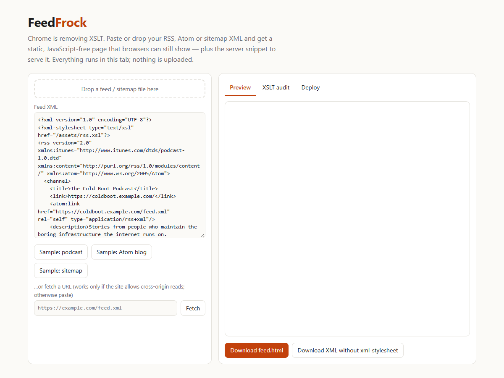

# FeedFrock

**Chrome is dropping XSLT — turn your styled RSS, Atom and sitemap XML into a static, JavaScript-free page browsers can still show.**

> Built by the daily routine on 2026-10-13; published on 2026-10-22 because the push failed (GitHub access). Reconstructed from the run's own event log.



```text
$ node cli.js examples/podcast.xml examples/blog.atom examples/sitemap.xml --out-dir site --strip-pi
examples/podcast.xml: RSS, 2 entries — XSLT stylesheet: /assets/rss.xsl  → will render as raw XML in Chrome after removal
  wrote site/podcast.html (4826 chars)
  wrote site/podcast.clean.xml (xml-stylesheet line removed)
examples/blog.atom: Atom, 2 entries — XSLT stylesheet: /pretty-feed-v3.xsl  → will render as raw XML in Chrome after removal
  wrote site/blog.html (4134 chars)
  wrote site/blog.clean.xml (xml-stylesheet line removed)
examples/sitemap.xml: sitemap, 5 URLs — XSLT stylesheet: //example.com/main-sitemap.xsl  → will render as raw XML in Chrome after removal
  wrote site/sitemap.html (4101 chars)
  wrote site/sitemap.clean.xml (xml-stylesheet line removed)
```

## Run it

- **In the browser (no install):** open `index.html` — paste or drop a feed, see the preview, download `feed.html`. Nothing is uploaded.
- **CLI (Node ≥ 18, zero dependencies):** `node cli.js feed.xml --out-dir public --feed-url https://example.com/feed.xml`
- **In CI:** `node cli.js feed.xml sitemap.xml --check` exits `1` while any file still depends on an `<?xml-stylesheet?>` XSLT.
- **Server config:** `node cli.js --snippets --xml-path /feed.xml --html-path /feed.html` prints nginx / Apache / Vercel / Cloudflare Worker snippets that serve the HTML page to browsers (`Accept: text/html`) and the untouched XML to feed readers.

`npm test` runs the 28 tests; `npm run build` regenerates `index.html` from `src/`.

## Why it exists

Many sites style their feeds in the browser with an `<?xml-stylesheet type="text/xsl" …?>` line: Jekyll/Hugo "pretty feed" themes, WordPress feed themes, podcast hosts, and `sitemap.xml` generators. Chrome's deprecation notice schedules removal of XSLT support for stable on **2026-11-17** (see `RESEARCH.md` for sources and caveats). After that, visitors who click your RSS link see a raw XML tree instead of your page. Feed readers keep working; the human landing page does not.

The fix is not a new reader, it is a static page. FeedFrock parses your feed, renders a clean, accessible, light/dark page with **no JavaScript and no XSLT**, and gives you the web-server rule to serve it to browsers only.

## What it does

- Parses RSS 2.0, RSS 1.0/RDF, Atom (including `xhtml`/`html`/`text` content), podcast tags (`itunes:*`, enclosures → `<audio>` player), `sitemap.xml` and sitemap indexes with its own small well-checking XML parser (errors carry line numbers).
- Detects and reports the XSLT stylesheet(s) a file depends on.
- Entry HTML goes through an **allowlist sanitizer** (no scripts, handlers, `javascript:`/`data:` URLs, iframes, styles; links get `rel="noopener noreferrer nofollow"`). The generated page also carries a strict Content-Security-Policy.
- Writes a copy of the XML without the `xml-stylesheet` line (`--strip-pi`).

## Limitations

- It renders a **snapshot**. Regenerate `feed.html` whenever the feed changes (run the CLI in your build or a cron job); it does not poll.
- Server snippets rely on content negotiation (`Accept: text/html`). A few tools send `text/html` when fetching feeds; test on your host with `curl -sI -H 'Accept: text/html' …/feed.xml` and `curl -sI …/feed.xml`. The snippets are templates, not tested against every host version. Static hosts that cannot read headers (e.g. plain GitHub Pages) should link to `feed.html` instead.
- The Chrome date comes from Chrome's published deprecation notice as reported by secondary sources while this was built (the notice itself could not be fetched in the build sandbox); version numbers differ between sources. Check the notice for the current plan.
- Not a full XML implementation: no external entities/DTD processing (by design), no XML Schema, no namespaces beyond the common feed prefixes. Atom with a prefixed root (`<atom:feed>`) is supported; other exotic prefixings are not.
- Time zones: dates are shown in UTC, `YYYY-MM-DD`.
- The in-browser URL fetch only works when the target sends CORS headers; otherwise paste the XML.
- Does not replicate your custom XSLT design. It produces one clean, neutral theme.

## License

MIT — see `LICENSE`.

---
Development Experiment 072 of dev-experiments-365
