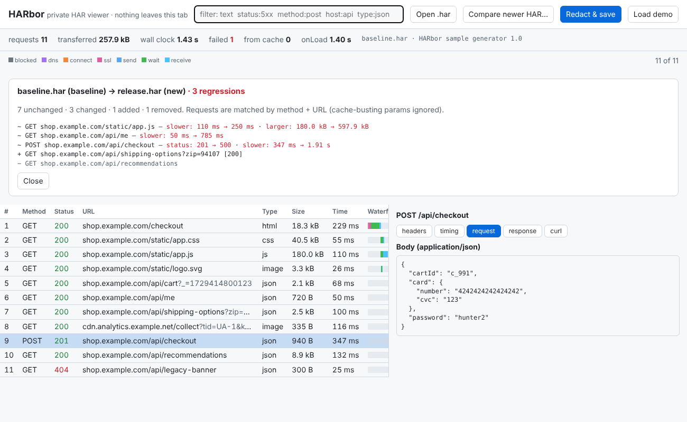

# HARbor

**Open a HAR file privately: waterfall, filter, copy-as-curl, strip the secrets, and diff two captures — one HTML file, nothing uploaded.**



```text
$ node cli.js diff samples/baseline.har samples/release.har
11 → 11 requests · 7 unchanged, 3 changed, 1 added, 1 removed

~ GET shop.example.com/static/app.js
    ! slower: 110 ms → 250 ms
    ! larger: 180.0 kB → 597.9 kB
~ GET shop.example.com/api/me
    ! slower: 50 ms → 785 ms
~ POST shop.example.com/api/checkout
    ! status: 201 → 500
    ! slower: 347 ms → 1.91 s
+ GET shop.example.com/api/shipping-options?zip=94107  [200]
- GET shop.example.com/api/recommendations

3 regressions
```

## Run it

```bash
# Web: just open the file (works offline)
open index.html          # or drag a .har onto it; add #demo to the URL for a sample

# CLI (Node 18+, zero dependencies)
node cli.js summary capture.har
node cli.js ls capture.har status:5xx slower:500 -type:image
node cli.js curl capture.har method:post host:api
node cli.js redact capture.har -o safe.har         # then share safe.har
node cli.js diff before.har after.har --fail-on-regression   # exit 1 in CI
```

Get a HAR from Chrome/Edge/Firefox: DevTools → Network → *Save all as HAR*.

## Why it exists

A HAR is the standard way to hand someone "what my browser did" — and it contains your session: `Authorization` headers, cookies, JWTs, API keys in query strings, passwords and card numbers in bodies. Hosted viewers want you to upload that; converters give you a curl line but no picture. HARbor is the local, portable middle: parse in your tab, see the waterfall, find the one failing call, and send a **redacted** capture to whoever needs it.

## What it does

- **Waterfall** with phases (blocked, DNS, connect, TLS, send, wait, receive); click a row for headers, timing diagnosis ("mostly waiting on the server"), request/response bodies (JSON pretty-printed), curl.
- **Filter language:** free text, `status:404` / `status:5xx` / `status:failed`, `method:post`, `host:`, `type:json`, `slower:500` (ms), `larger:100k`, `header:name` or `header:name=value`, `body:text`, `cached:`, quotes for phrases, `-` to negate.
- **Summary:** totals, failures, slowest, weight by type and host, URLs fetched repeatedly.
- **Copy as curl** with safe shell quoting (skips HTTP/2 pseudo-headers, maps `accept-encoding` to `--compressed`).
- **Redact:** masks sensitive headers, cookies, secret-named query params and JSON/form fields (`token`, `password`, `secret`, `api_key`, whole `card` objects…), JWTs, `Bearer`/`Basic` tokens, AWS/GitHub/Stripe-style keys, and Luhn-valid card numbers anywhere in text; drops binary bodies; optionally emails (`--emails`) or all bodies (`--no-bodies`). The output is **re-scanned**; leftovers are reported and the CLI exits 1.
- **Diff:** match requests by method + URL (cache-busting params like `_`, `ts`, `nonce` ignored), report status changes, slower/faster, larger/smaller, added/removed, and count regressions.

## Sample run

```text
$ node cli.js redact samples/release.har -o /tmp/safe.har
masked 17 values (10 headers, 0 cookies, 6 fields/params, 1 token patterns); dropped 0 binary/body payloads -> /tmp/safe.har

$ node cli.js ls samples/release.har status:5xx
 10  POST   500    1.91 s      940 B  json  shop.example.com/api/checkout

$ node cli.js curl samples/release.har method:post
curl 'https://shop.example.com/api/checkout' -X POST -H 'user-agent: Mozilla/5.0' -H 'authorization: Bearer eyJ…' …

$ npm test        # 14 tests
```

Regenerate the samples with `node samples/make.js`; rebuild the single file with `node build.js`.

## Limitations

- **Redaction is heuristic.** It catches the common shapes and re-scans, but it cannot know that a free-text field or an opaque ID is sensitive. Open the redacted file and look before you share it. Names, addresses and arbitrary IDs are not masked.
- Response bodies are shown only if the browser stored them in the HAR (Chrome often omits them; Firefox and "with content" exports include them). Binary bodies are not rendered.
- Timings are as recorded by the browser; HARbor does not re-measure. HAR 1.2 `ssl` is treated as part of `connect`.
- Diff matches by method+URL; a changed query string value counts as a different request (shown as added/removed).
- Very large HARs (hundreds of MB) are limited by browser memory; use the CLI.
- Not a proxy or recorder — it reads files.

## License
MIT

---
Development Experiment 080 of dev-experiments-365
