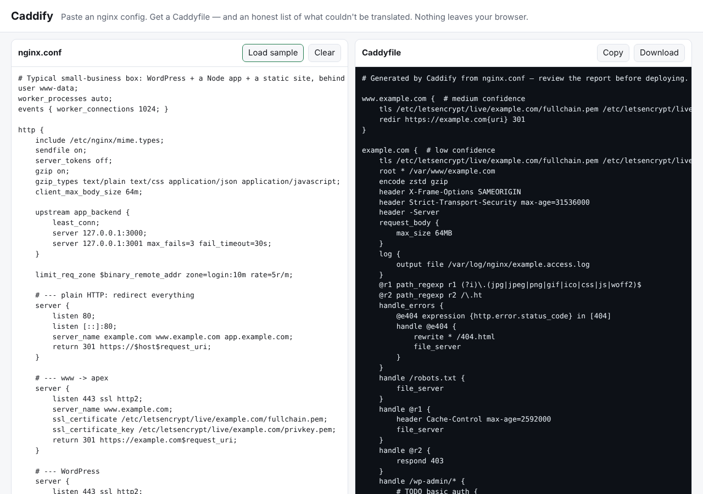

# Caddify

Paste an nginx config, get a Caddyfile — plus an honest list of everything that could not be translated, and why.



**Try it:** open `index.html` (one self-contained file, works offline, nothing is uploaded) — or `node cli.js /etc/nginx/nginx.conf`.

## Demo

```nginx
# nginx
upstream app { least_conn; server 127.0.0.1:3000; server 127.0.0.1:3001 max_fails=3 fail_timeout=30s; }
server {
    listen 443 ssl http2;
    server_name app.example.com;
    ssl_certificate     /etc/letsencrypt/live/example.com/fullchain.pem;
    ssl_certificate_key /etc/letsencrypt/live/example.com/privkey.pem;
    location /api/ {
        proxy_pass http://app/v2/;
        proxy_set_header Host $host;
        proxy_set_header X-Forwarded-For $proxy_add_x_forwarded_for;
        proxy_read_timeout 90s;
    }
    location /login { limit_req zone=login burst=5; proxy_pass http://127.0.0.1:3000; }
}
```

```caddyfile
# Caddify output
app.example.com {  # low confidence
	tls /etc/letsencrypt/live/example.com/fullchain.pem /etc/letsencrypt/live/example.com/privkey.pem
	handle /login* {
		reverse_proxy 127.0.0.1:3000
	}
	handle_path /api/* {
		rewrite * /v2{uri}
		reverse_proxy 127.0.0.1:3000 127.0.0.1:3001 {
			lb_policy least_conn
			max_fails 3
			fail_duration 30s
			transport http {
				read_timeout 90s
			}
		}
	}
}
```
```
MANUAL  limit_req zone=login burst=5
        Rate limiting needs the third-party `caddy-ratelimit` module.
DIFFERS ssl_certificate …/letsencrypt/…
        These look like certbot certificates. Caddy can obtain and renew its own — you can usually delete this `tls` line.
no-op   proxy_set_header Host $host  → Caddy already forwards the original Host header.
no-op   proxy_set_header X-Forwarded-For …  → Caddy appends X-Forwarded-For by default.
```

The `Host`/`X-Forwarded-*` lines vanish because Caddy does them by default; the rate limit is *not* silently dropped — it is
called out with the line number so you can decide.

## Install / run

```bash
node cli.js nginx.conf                 # Caddyfile on stdout, report on stderr
node cli.js nginx.conf -o Caddyfile    # write to a file
node cli.js nginx.conf --json          # {caddyfile, report, stats, sites}
node cli.js nginx.conf --strict --quiet   # exit 2 if anything needs manual work (CI)
cat nginx.conf | node cli.js -         # stdin
npx caddify nginx.conf                 # after publishing to npm; no dependencies
```
`include` directives are resolved relative to the config file (with `*` globs). In the browser, paste the included files in too.
Rebuild the single HTML file after editing `src/`: `node build.js`. Tests: `npm test` (Node ≥ 18, zero dependencies).

## What it translates

server/listen/server_name → site addresses · `location` (exact, `^~`, prefix, `~`, `~*`) → `handle`/`handle_path` with nginx's
evaluation order · `proxy_pass` (incl. URI rewriting, upstream blocks, unix sockets, https) → `reverse_proxy` with
`lb_policy`, `max_fails`, timeouts, header_up/down · `fastcgi_pass` → `php_fastcgi` (and folds the classic WordPress `try_files … /index.php?$args`) ·
`return`/`rewrite` → `redir`/`respond`/`rewrite` · `try_files`, `root`, `alias`, `autoindex`, `error_page` → `handle_errors` ·
`ssl_certificate*`, `ssl_protocols` → `tls` · `add_header`, `expires`, `server_tokens` → `header` · `gzip` → `encode` ·
`allow`/`deny`, `limit_except`, `client_max_body_size`, `access_log`. Plain HTTP→HTTPS redirect servers are dropped (Caddy does it automatically).
nginx variables map to Caddy placeholders (`$host`→`{host}`, `$http_x_foo`→`{header.X-Foo}`, regex captures→`{re.name.1}` …).

Every directive lands in one of four buckets in the report: **translated**, **approximate** (works, semantics differ — explained),
**no-op** (Caddy does it by default / not needed), **manual** (no equivalent — with the Caddy-side suggestion). Each site block
gets a confidence badge (high / medium / low).

## Why it exists

Caddy's own `nginx-adapter` is unfinished and drops what it can't express; people keep posting configs to the Caddy forum asking for
hand translation. The valuable part of a migration isn't the 90% that maps cleanly — it is knowing exactly which 10% needs your attention.
See [RESEARCH.md](RESEARCH.md).

## Sample run

```
$ node cli.js samples/production.conf --quiet | head -5
# Generated by Caddify from nginx.conf — review the report before deploying.

www.example.com {  # medium confidence
	tls /etc/letsencrypt/live/example.com/fullchain.pem /etc/letsencrypt/live/example.com/privkey.pem
	redir https://example.com{uri} 301

$ node cli.js samples/production.conf --quiet --json | node -e "console.log(JSON.parse(require('fs').readFileSync(0)).stats)"
{ ok: 59, differs: 6, noop: 20, manual: 4 }

$ npm test
# tests 27   # pass 27   # fail 0
```

## Limitations (honest)

- **Not validated against a real Caddy binary in this run** (the sandbox could not download one). Tests check structure,
  brace balance and the exact text produced for each mapping — please run `caddy validate --config Caddyfile` before deploying.
- Output targets Caddy 2.x. `lb_policy ip_hash`/`weighted_round_robin` and `{http.error.status_code}` expressions need a recent 2.x.
- Not translated (reported as manual): `if`, `map`, `geo`, `set`, caching, rate limiting, `sub_filter`, named locations, nested locations,
  variables inside `proxy_pass`/`root`, regex `server_name`, htpasswd files, stream/TCP proxying.
- nginx's "regex location beats prefix unless `^~`" rule is approximated by emission order; Caddy sorts `handle` blocks by specificity.
  Servers that mix both are flagged.
- A few semantic differences are only *noted*, not modelled (e.g. nginx's `add_header` inheritance replacing instead of merging).
- Regexes using lookahead/back-references are rejected because Caddy uses Go RE2.

MIT licensed.

---
Development Experiment 081 of dev-experiments-365
