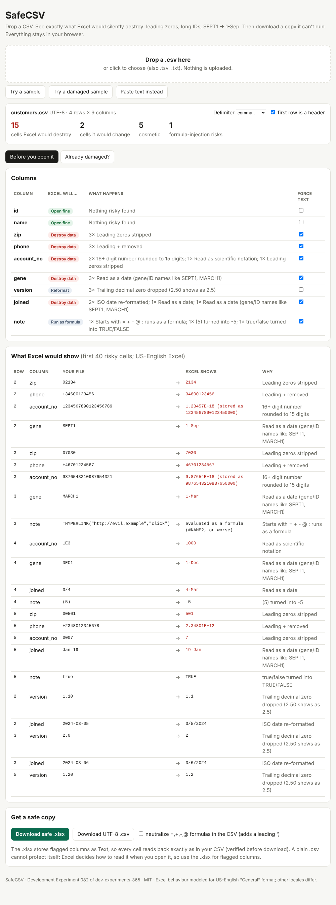

# SafeCSV

Drop a CSV, see exactly what Excel would silently destroy (leading zeros, long IDs, `SEPT1` → `1-Sep`), then download a copy it can't ruin.



**Try it:** open `index.html` (one self-contained file, works offline, nothing is uploaded), or run `node cli.js scan yourfile.csv`.

## Demo

```text
$ node cli.js scan samples/customers.csv
customers.csv (UTF-8, delimiter ",")
4 rows x 9 columns, 23 risky cell(s) in 6 column(s) that need Text format.
  [destructive] zip: 3 x leading-zero
      row 2: "02134" -> Excel shows "2134"
      row 3: "07030" -> Excel shows "7030"
  [destructive] phone: 3 x plus-prefix
      row 2: "+34600123456" -> Excel shows "34600123456"
      row 3: "+46701234567" -> Excel shows "46701234567"
  [destructive] account_no: 2 x long-digits, 1 x e-notation, 1 x leading-zero
      row 2: "1234567890123456789" -> Excel shows "1.23457E+18  (stored as 1234567890123450000)"
      row 3: "9876543210987654321" -> Excel shows "9.87654E+18  (stored as 9876543210987650000)"
      row 4: "1E3" -> Excel shows "1000"
  [destructive] gene: 3 x month-name
      row 2: "SEPT1" -> Excel shows "1-Sep"
  ...
$ node cli.js fix samples/customers.csv -o customers.safe.xlsx
Wrote customers.safe.xlsx: 5 rows, 6 column(s) forced to Text, round-trip verified cell-for-cell.
```

Opened in LibreOffice and re-exported, the `.xlsx` reproduces the input CSV exactly. Opening the original CSV in Excel does not.

## Install / run

- **Browser:** open `index.html`. Drag in a file, or paste text.
- **CLI (Node 18+, zero dependencies):** `node cli.js <command> file.csv`, or `npm link` and use `safecsv`.

| Command | What it does |
|---|---|
| `scan f.csv [--json]` | Report every cell Excel would change or destroy. Exit 1 if anything destructive. |
| `check f.csv` | Quiet CI gate: exit 1 on destructive/altered cells. |
| `fix f.csv [-o out.xlsx\|out.csv] [--guard-formulas]` | Write an Excel-safe `.xlsx` (flagged columns stored as Text, round-trip verified) or a UTF-8-BOM `.csv`. |
| `diagnose f.csv [--repair-zeros -o fixed.csv]` | Look for damage Excel already did: date-converted IDs, `1.23E+18`, 15-digit rounding, stripped zeros, `#NAME?`. |

Options: `--delimiter ';'` (auto-detected otherwise), `--no-header`, `--json`.

## Why it exists

Excel decides how to read every CSV cell when you open it, and the change is irreversible once you save. Zip codes lose their zero, 16-digit IDs are rounded to 15 digits, `1E3` becomes 1000, `SEPT1` becomes a date (HUGO renamed 27 human genes over this), and a cell starting with `=` or `@` runs as a formula. The standard advice (the Text Import Wizard, column by column, every time) is manual and useless once the file is already saved. See [RESEARCH.md](RESEARCH.md) for sources.

## What it checks

Leading zeros · leading `+` · 16+ digit numbers · 12–15 digit numbers · scientific-notation lookalikes · month-name IDs (`SEPT1`, `MARCH1`, `Jan 19`, `1-Mar`) · `1-2` / `3/4` / `1/2/20` dates · ISO dates · `(5)` negatives · `true`/`false` · trailing zeros (`1.10`) · cells over 32,767 chars · formula injection (`= + - @`) · row/column limits · ragged rows · encoding (UTF-8/UTF-16/BOM, windows-1252 fallback).

## Limitations

- The Excel model is for **US-English "General" format**. Other locales (e.g. day-first dates, comma decimals) differ; the report says "Excel shows" with that caveat.
- The behaviour model is derived from documented Excel behaviour and tested against LibreOffice for the `.xlsx` round trip, **not** against a copy of Excel itself.
- `diagnose` is heuristic: it can only say damage is *likely*. Date-eaten IDs and rounded digits cannot be recovered from the damaged file. Only stripped zeros can be padded back (a guess based on the column's usual width).
- A `.csv` cannot protect itself. Use the `.xlsx` output for flagged columns; `--guard-formulas` prefixes dangerous cells with `'`, which changes their content.
- The whole file is held in memory (fine for hundreds of thousands of rows, not gigabytes). `.xlsx` output is a single sheet with no styling beyond a bold header, frozen row and filter.

## Develop

`npm test` (node:test, no dependencies) · `npm run build` regenerates `index.html` from `src/`.

## Sample run

```text
# tests 17
# pass 17
# fail 0
```

MIT licensed.

---
Development Experiment 082 of dev-experiments-365
