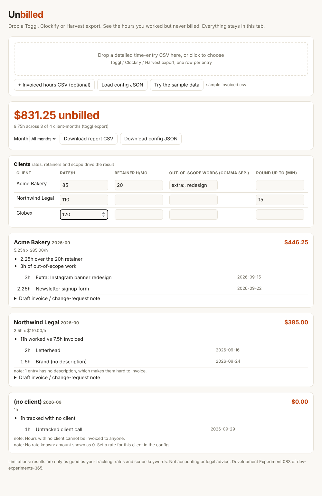

# Unbilled

Drop a Toggl, Clockify or Harvest export and see the hours you worked but never billed: over the retainer, out of scope, not invoiced, or marked non-billable by mistake.



**Try it:** open `index.html` (one self-contained file, works offline, nothing is uploaded) and click *Try the sample data*, or run `node cli.js report samples/toggl.csv --config samples/config.json --invoiced samples/invoiced.csv`.

## Demo

```text
$ node cli.js report samples/toggl.csv --config samples/config.json --invoiced samples/invoiced.csv
Unbilled: $831.25 (9.75h) across 3 of 4 client-months

Acme Bakery  2026-09   $446.25  (5.25h x $85.00/h)
  - 2.25h over the 20h retainer
  - 3h of out-of-scope work
      3h  Extra: Instagram banner redesign
      2.25h  Newsletter signup form

Northwind Legal  2026-09   $385.00  (3.5h x $110.00/h)
  - 11h worked vs 7.5h invoiced
      2h  Letterhead
      1.5h  Brand (no description)
  note: 1 entry has no description, which makes them hard to invoice.

(no client)  2026-09   $0.00  (1h)
  - 1h tracked with no client
      1h  Untracked client call
  note: Hours with no client cannot be invoiced to anyone.
  note: No rate known: amount shown as 0. Set a rate for this client in the config.

----- draft: Acme Bakery 2026-09 -----
Subject: Additional work for 2026-09 (Acme Bakery)
```

Add `--drafts` and it also writes the note you would send the client ("the following 5.25h falls outside the retainer and comes to $446.25 at $85.00/h: ...").

## Install / run

- **Browser:** open `index.html`. Drop the export, optionally add an invoiced-hours CSV and edit rates, retainers and out-of-scope words in the table. Results update live.
- **CLI (Node 18+, zero dependencies):** `node cli.js report time.csv`, or `npm link` and use `unbilled`.

| Command | What it does |
|---|---|
| `report <time.csv>` | Per client-month leak report. Flags: `--config c.json`, `--invoiced inv.csv`, `--month 2026-09`, `--json`, `--csv out.csv`, `--drafts`, `--date-order DMY\|MDY` |
| `init <time.csv>` | Writes a starter config with every client and the rate found in the export |
| `--fail-on-leak N` | Exit 1 if the unbilled total is at least N (a monthly cron or CI gate) |

Exit codes: 0 ok, 1 leak over the `--fail-on-leak` threshold, 2 bad input.

## How it decides what is unbilled

Per client and month, after dropping internal time (`internal`, `admin`, `lunch`, `break`, `vacation`, `pto`, `holiday`, `sick`, whole-word match; configurable):

- **Retainer client** (`retainerHours` set): work past the cap, plus anything matching `outOfScope` words (or not matching `inScope` words), minus any hours invoiced beyond the cap.
- **Hourly client with an invoiced CSV** (`client,month,hours`): hours worked minus hours invoiced.
- **Harvest export** (has `Invoiced?`): billable entries not marked invoiced, plus entries marked non-billable on a client you bill.
- **Anything else:** entries flagged non-billable on that client.
- **No client:** shown as hours, never priced.

Rate comes from your config, else the export's billable-rate column, else `defaultRate`. Set `minIncrementMinutes` to see what rounding up to 15 minutes would add.

## Why it exists

Agencies and freelancers lose billable work because it is never matched to an invoice. A survey summarized by Breeze says 78% of agencies rarely or only sometimes charge for out-of-scope work. Trackers (Toggl, Harvest) show hours but do not compare them with what you agreed or billed, and the dedicated tools are paid SaaS that want your time data. See `RESEARCH.md`.

## Limitations

- It reads detailed time-entry exports only (one row per entry), not summary reports.
- Keyword scope rules are blunt. Review the listed entries before sending anything to a client.
- Ambiguous `03/04/2026` dates default to month/day unless the file proves otherwise (a warning is shown). Use `--date-order`.
- Hourly clients with no invoice data and no billable flags cannot be assessed: nothing is reported for them.
- Currency is a label only; no conversion. Not accounting or legal advice.

## Tests

`npm test` (14 tests: parsing, three export presets, date orders, retainer/scope/invoice math, CLI exit codes). `npm run build` regenerates `index.html` from `src/`.

## Sample run

```text
$ npm test
# tests 14
# pass 14
# fail 0

$ node cli.js report samples/harvest.csv
Unbilled: $498.75 (5.25h) across 1 of 1 client-months

Initech  2026-08   $498.75  (5.25h x $95.00/h)
  - 3.25h billable but not marked invoiced
  - 2h on this client marked non-billable
      3.25h  Hotfix prod outage
      2h  Training session for ops team
```

---
Development Experiment 083 of dev-experiments-365
