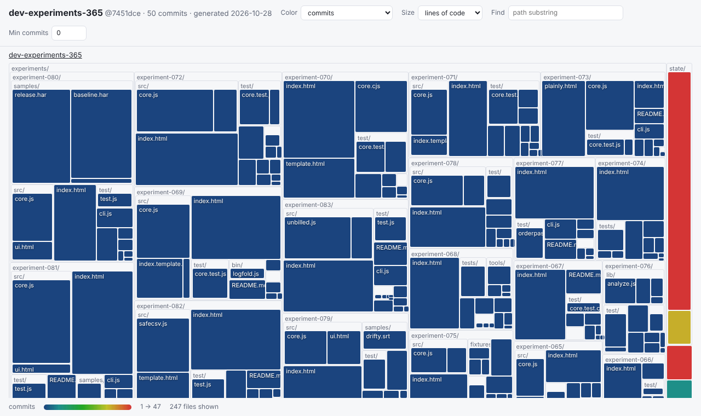

# churnmap

See where your repo's churn, ownership and risk live — one `git log`, one self-contained HTML treemap, nothing uploaded.



*Every rectangle is a file (size = lines of code), colored by how often it changed. Click a folder to zoom, hover for details.*

## Run it

```bash
node cli.js /path/to/repo --since "6 months ago"
```

Zero dependencies, Node ≥ 18 and `git` on PATH. Output is a single `<repo>.churnmap.html` you can open, email or attach to a ticket.

## Sample run

Real output, run against this monorepo (shallow clone, 50 commits):

```
churnmap: dev-experiments-365@7451dce — 247 files, 247 touched in 50 commits

Top hotspots (churn × size):
  state/experiments.json                            47 commits     681 lines  5 authors
  README.md                                         47 commits      96 lines  5 authors
  state/pending_promotion.json                      19 commits      97 lines  1 author
  ROUTINE.md                                         2 commits      87 lines  2 authors
  experiments/experiment-081/index.html              1 commits     765 lines  1 author

Bus factor 1 (>=5 commits, one author):
  state/pending_promotion.json  (19 commits)
```

## What the map shows

Color by: **commits**, **lines changed**, **recency** of last change, **distinct authors**, **hotspot** (churn × log size — the "code as a crime scene" heuristic) or **bus factor 1** (≥5 commits, a single author). Size by lines of code, commits or lines changed. Filter by path substring or minimum commits. Tooltip shows lines, commits, +/−, authors, top owner share, first/last change.

## Options

```
-o, --out <file>   output HTML (default ./<repo>.churnmap.html)
--since <when>     "6 months ago", "2026-01-01"
--max <n>          only the last n commits
--no-ignore        include lockfiles, minified files, vendor/, dist/, images
--top <n>          hotspots to print (default 10)
--json             print the raw data set instead of HTML
```

## Why it exists

Onboarding to an unfamiliar codebase, planning a refactor, or asking "who actually knows this file?" all start with *where does the change happen?* Answers today are SaaS dashboards (CodeScene, Sourcegraph), text-only `git-quick-stats`, or a clunky code-maat pipeline. An Ask HN thread on dev tools people wish existed asked for exactly a heat-map of the most frequently and recently edited files. This is that, as a file you can generate in a second.

## Tests

`npm test` — 7 tests build real throwaway git repos (deleted files, lockfiles, `--max`, bus factor, `</script>` in filenames, empty/non-repos, and that the generated page's script parses).

## Limitations

- Renames are not followed (`--no-renames`): a renamed file starts a fresh history. Merge commits are skipped.
- Only files that exist at `HEAD` and are text (≤ 2 MB) are shown; deleted history is not mapped.
- "Authors" are git author names as written — the same person under two names counts twice (no `.mailmap` support yet).
- Churn is a signal, not a verdict: generated files and busy config files top the list too.
- Very large repos (100k+ files) will produce a heavy HTML page; use `--since` / `--max`.

---
Development Experiment 084 of dev-experiments-365
