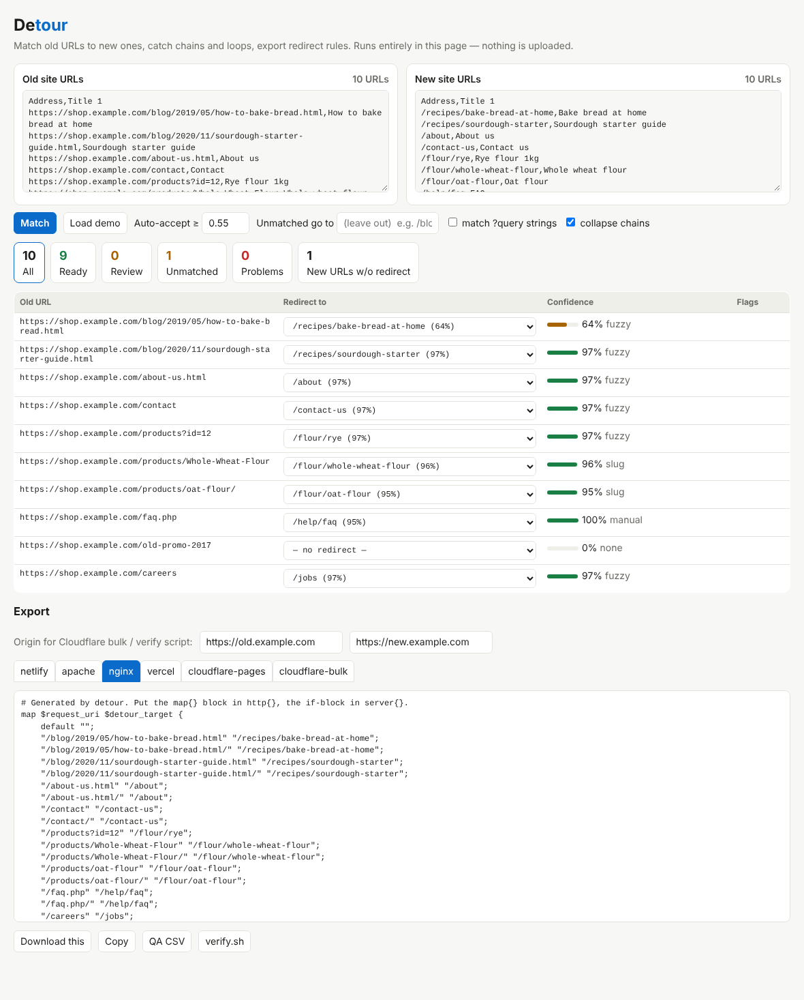

# Detour

Match your old site's URLs to the new site's, catch redirect chains and loops, and export ready-to-paste rules for Netlify, Vercel, Apache, nginx and Cloudflare — one offline HTML file, nothing uploaded.



*Old URLs on the left, best match (with a runner-up dropdown) in the middle, confidence and problem flags on the right. Click "Load demo" in `index.html` to see it.*

## Run it

```bash
open index.html                                            # the whole app, no server, no install
node cli.js match old.csv new.csv --out detour-out         # same engine as a zero-dependency CLI (Node >= 18)
```

Inputs can be a plain list of URLs, a CSV (Screaming Frog exports work as-is: `Address`, `Title 1`, `Status Code`), or a `sitemap.xml`. Adding a title/H1 column to **both** lists lets Detour match pages whose URLs share nothing (`/p/1234` → `/flour/rye`).

## Sample run

Real output from `node cli.js match examples/old.csv examples/new.csv`:

```
detour: 10 old URLs - 9 get a redirect (0 exact), 0 need review, 1 unmatched

1 unmatched:
  https://shop.example.com/old-promo-2017

1 new-site URLs receive no redirect (fine for brand-new pages, suspicious otherwise).
```

…and the `netlify/_redirects` it wrote:

```
/blog/2019/05/how-to-bake-bread.html /recipes/bake-bread-at-home 301
/blog/2020/11/sourdough-starter-guide.html /recipes/sourdough-starter 301
/about-us.html /about 301
/contact /contact-us 301
/products id=12 /flour/rye 301
/products/Whole-Wheat-Flour /flour/whole-wheat-flour 301
/products/oat-flour /flour/oat-flour 301
/faq.php /help/faq 301
/careers /jobs 301
```

Already have a redirect map from a spreadsheet? `node cli.js check examples/map.csv` audits it (real output):

```
detour: 6 old URLs - 6 get a redirect (0 exact), 0 need review, 0 unmatched

2 redirect LOOPS (dropped from output):
  /team  ->  /about/team
  /about/team  ->  /team

2 CONFLICTS: same source, different targets:
  /contact  ->  /contact-us
  /contact  ->  /get-in-touch

1 chains collapsed to the final target:
  /pricing  ->  /plans  =>  /plans/2026 (1 extra hop)
```

## What it does

- **Matches** by exact path, then case/slash/extension-insensitive path, then slug, then IDF-weighted token similarity with trigram typo tolerance, then page titles. Every row shows a confidence score and up to five alternatives; close runner-ups are flagged `ambiguous`.
- **Never silently guesses**: matches under the threshold (default 0.55) are left out of the export and listed for review. Optional `--fallback /blog/` sends the rest to a landing page instead.
- **Analyses the map**: loops, redirect chains (collapsed to the final target by default), conflicting duplicate sources, case/slash collisions, "unchanged" self-redirects, targets missing from the new site, and new URLs nobody redirects to.
- **Exports** `netlify`, `apache` (anchored `RedirectMatch`, `RewriteCond` for query rules), `nginx` (one `map` on `$request_uri`, with trailing-slash variants), `vercel` (`vercel.json`), `cloudflare-pages` and `cloudflare-bulk`, plus `qa.csv` (every row, status, flags, runner-up) and `verify.sh`, a curl script that checks each old URL really answers 301 to the right place once the rules are live.
- Edit any row in the page (pick another candidate, type a URL, or drop the redirect); chains and loops are re-checked instantly.

`--strict` makes the CLI exit 1 if any loop, conflict, chain, review item or unmatched URL remains, so it can gate a migration PR in CI.

## Why it exists

Replatforming (Shopify, Webflow, WordPress, a CMS swap) leaves thousands of old URLs that someone matches by hand in a spreadsheet, then re-types into one platform's syntax. Existing helpers either format pairs you already matched, target a single platform, or are hosted tools that want your URL list (and sometimes an account). Detour does the matching *and* the checking *and* the multi-target export, locally.

## Limitations

- Matching is lexical (words in URLs and titles), not semantic: it cannot know that `/stuff/x7` is "Rye flour" without a shared title. Review the yellow rows; that is what the confidence score is for.
- It never fetches anything: it cannot see real HTTP status codes, canonical tags or whether a target exists beyond your new-site list. `verify.sh` does the live check after you deploy.
- Rule syntax is generated from the documented behaviour of each platform; check the platform's own limits on rule counts and query matching. `cloudflare-pages` skips query-string rules (unsupported there). `cloudflare-bulk` writes `source,target,301` rows with the origins you give it and may need columns adjusted to your list's import options.
- Sitemap *index* files are detected but not followed (paste the child sitemaps).
- Chain/loop detection treats paths case-insensitively and ignores trailing slashes, but keeps file extensions (`/about.html` ≠ `/about`).

## Develop

```bash
npm test        # rebuilds index.html from lib.js + template.html, then runs 22 tests (node --test)
```

`lib.js` is the whole engine (browser and Node). `template.html` is the UI; `node build.js` inlines the engine into `index.html`.

MIT licensed. Development Experiment 085 of dev-experiments-365
